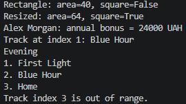

# Самостійна робота №1. Базовий синтаксис C# і класи

## Виконання роботи

Rectangle перевіряє розміри, обчислює площу та визначає, чи є прямокутник квадратом. Employee має доступне лише для читання ім’я та обчислює бонус від річного окладу. Playlist надає доступ до треків через індексатор, перевіряє межі й копіює вхідний масив.

## Запуск з кореня OOP-Zaluzhnyi

    dotnet run --project IndependentWorks/IndependentWork1

## Результат запуску

