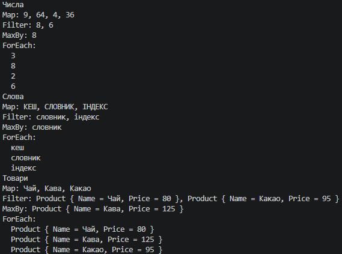

# Самостійна №10. Делегати й лямбда-вирази

Утиліти для колекцій застосовують одну й ту саму логіку перебору до чисел, слів і товарів. Func повертає перетворене значення або ключ, Predicate визначає, які елементи залишити, а Action виконує дію для кожного елемента.

Map і Filter відповідають LINQ Select та Where, але одразу формують списки. MaxBy за один прохід знаходить найбільший ключ і при рівності залишає перший елемент. Для порожньої послідовності він викидає InvalidOperationException. ForEach виконує передану дію одразу.

## Запуск з кореня OOP-Zaluzhnyi

```powershell
dotnet run --project IndependentWorks/IndependentWork10
```

## Вивід програми


