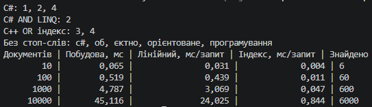

# Самостійна №11. Інвертований індекс

Словник зберігає для кожного слова множину ідентифікаторів документів. AND-пошук перетинає множини, OR-пошук їх об’єднує. Нормалізація однакова для запитів і документів, тому C#, C++ і C залишаються окремими токенами. Повторне додавання документа замінює старі входження.

Програма порівнює час пошуку за індексом і повного сканування на 10, 100, 1 000 та 10 000 документах. Перед вимірюванням вона звіряє всі ідентифікатори знайдених документів. Вартість побудови вимірюється окремо. Індекс використовує додаткову пам’ять, зате повторні запити не потребують повторної токенізації всіх документів. Числа залежать від обладнання та набору даних.

## Запуск з кореня OOP-Zaluzhnyi

```powershell
dotnet run --project IndependentWorks/IndependentWork11 -c Release -- --demo
```

Для інтерактивного пошуку запусти без параметра `--demo`.

## Вивід програми


