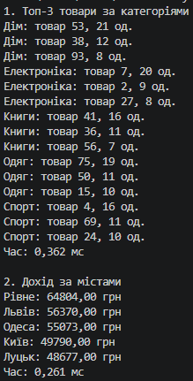
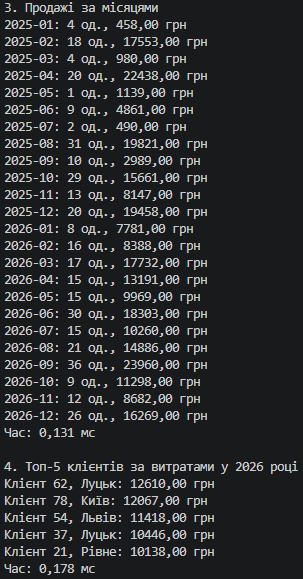

# Самостійна №12. LINQ та аналітика продажів

Демонстраційний набір містить по 100 товарів, клієнтів і продажів. Фіксоване зерно генератора відтворює дані. LINQ з’єднує записи за ID, групує продажі та обчислює чотири звіти: лідери категорій, дохід міст, продажі за місяцями й витрати клієнтів у 2026 році.

Кожен запит прогрівається й вимірюється окремо під час матеріалізації. Вивід у консоль не входить у замір. На час впливають обсяг даних, групування й сортування. Ранній відбір за роком у четвертому запиті зменшує кількість рядків для Join.

## Запуск з кореня OOP-Zaluzhnyi

```powershell
dotnet run --project IndependentWorks/IndependentWork12 -c Release
```

## Вивід програми




