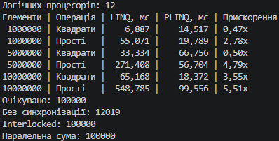

# Самостійна №13. Продуктивність і безпека PLINQ

На списках з 1, 5 та 10 мільйонами цілих чисел програма порівнює просту операцію піднесення до квадрата та дорожчу перевірку простоти. Для кожної комбінації вона перевіряє рівність сум і виводить медіану трьох вимірювань після прогріву. Прискорення розраховується як час LINQ, поділений на час PLINQ. Значення нижче 1 означає, що LINQ був швидшим. Генерація списків і вивід до часу запитів не входять.

Спільний лічильник без синхронізації може втрачати інкременти, тому його результат залежить від запуску. Interlocked.Increment виконує інкремент атомарно. Паралельна сума дає той самий правильний результат без спільного змінного лічильника. Для дешевих операцій витрати на розподіл і збирання результатів можуть перевищити виграш від паралельності.

## Запуск з кореня OOP-Zaluzhnyi

```powershell
dotnet run --project IndependentWorks/IndependentWork13 -c Release
```

## Вивід програми



На цьому запуску PLINQ прискорив перевірку простоти на всіх трьох обсягах. Для квадратів він був швидшим лише на 10 млн елементів. Лічильник без синхронізації дав 12 019 замість 100 000. Interlocked і паралельна сума дали по 100 000.
