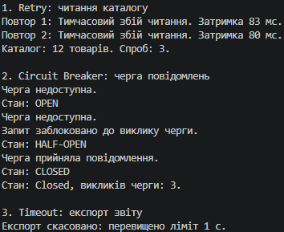

# Самостійна №14. Стратегії відмовостійкості Polly

- **Retry** повторює читання каталогу лише при IOException. Затримка зростає експоненційно й містить випадкову складову. Читання допускає повтор, бо не змінює дані.
- **Circuit Breaker** відкривається після двох збоїв черги. У відкритому стані він блокує звернення. Після паузи пробний виклик проходить і повертає стан CLOSED.
- **Timeout** обмежує експорт однією секундою. Операція передає токен скасування в Task.Delay.

Кожна стратегія має окремий приклад. У комбінованому конвеєрі зовнішній Timeout обмежує загальну тривалість, а внутрішній може обмежувати одну спробу. Повтор операцій зі зміною даних потребує гарантії ідемпотентності. Журнал показує причину збоїв, затримки й переходи між станами.

## Запуск з кореня OOP-Zaluzhnyi

```powershell
dotnet run --project IndependentWorks/IndependentWork14 -c Release
```

## Вивід програми


