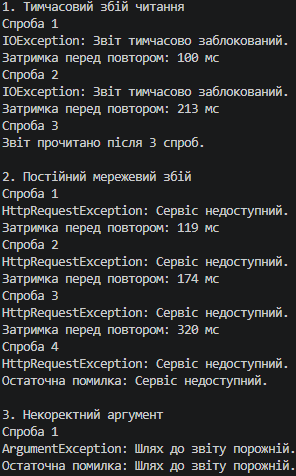

# Самостійна №15. Експоненційна затримка

Клас RetryPolicy повторює операцію після тимчасових винятків. Для повтору з індексом k затримка дорівнює початковій затримці, помноженій на 2 у степені k і випадковий коефіцієнт від 0,8 до 1,2 для jitter 20%. Три повтори дозволяють до чотирьох спроб. Власний предикат може уточнити, які помилки допускають повтор.

Експоненційне очікування дає ресурсу час відновитися. Jitter розносить повтори клієнтів у часі, щоб вони рідше зверталися одночасно. Повторювати варто лише тимчасові помилки. Для операцій зі зміною стану потрібна гарантія ідемпотентності. Після вичерпання спроб виняток передається викликачеві зі збереженим стеком.

## Запуск з кореня OOP-Zaluzhnyi

```powershell
dotnet run --project IndependentWorks/IndependentWork15 -c Release
```

## Вивід програми


