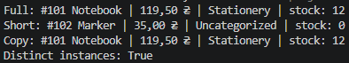

# Самостійна робота №2. Перевантаження конструкторів

## Виконання роботи

Product має п’ять властивостей лише для читання. Повний конструктор перевіряє й записує значення. Скорочений конструктор через this задає категорію Uncategorized і залишок 0. Конструктор копіювання використовує ті самі правила ініціалізації. ToString форматує ціну за українською локаллю.

## Запуск з кореня OOP-Zaluzhnyi

    dotnet run --project IndependentWorks/IndependentWork2

## Результат запуску

