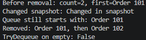

# Самостійна робота №3. Інкапсуляція у відкритому коді .NET

## Виконання роботи

У Queue<T> приватні поля _array, _head, _tail і _size описують кільцевий буфер. Публічні Enqueue та Dequeue підтримують узгодженість індексів і лічильника. Count дає змогу спостерігати розмір черги. TryDequeue повідомляє про порожню чергу через false. ToArray повертає окремий масив, тому заміна його елемента не змінює чергу. Для змінних об’єктів це поверхнева копія посилань.

[Вихідний код Queue<T>, .NET 10.0.0](https://github.com/dotnet/runtime/blob/v10.0.0/src/libraries/System.Private.CoreLib/src/System/Collections/Generic/Queue.cs)

## Запуск з кореня OOP-Zaluzhnyi

    dotnet run --project IndependentWorks/IndependentWork3

## Результат запуску

