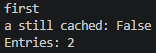
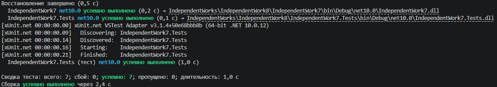

# Самостійна робота №8. Узагальнений FIFO-кеш

`Cache<TKey, TValue>` зберігає значення у словнику, а черга відстежує порядок додавання ключів. При переповненні кеш видаляє найстаріший ключ. Оновлення значення зберігає початкову позицію ключа в черзі.

## Запуск з кореня OOP-Zaluzhnyi

```powershell
dotnet run --project IndependentWorks/IndependentWork8/IndependentWork7
dotnet test IndependentWorks/IndependentWork8/IndependentWork7.Tests
```

## Результати

### Вивід програми



### Результати тестів

Усі 7 тестів пройшли.


