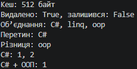

# Самостійна №9. Словники та множини

Кеш метаданих підтримує додавання, пошук і видалення файлів за іменем. Менеджер тегів показує об’єднання, перетин і різницю множин. Інвертований індекс знаходить документи, у яких є всі слова запиту.

Для пошуку за ключем Dictionary і HashSet мають середню складність O(1), тоді як пошук у List потребує проходу за O(n). Імена файлів і теги порівнюються без урахування регістру.

## Приклади з відкритого коду

1. Newtonsoft.Json використовує два словники для пошуку відповідності в обох напрямках. Це потребує двох індексів, зате пошук за будь-яким ключем у середньому займає O(1). [BidirectionalDictionary](https://github.com/JamesNK/Newtonsoft.Json/blob/13.0.3/Src/Newtonsoft.Json/Utilities/BidirectionalDictionary.cs)
2. LINQ Distinct зберігає вже побачені елементи в HashSet. Add повертає true лише для нового значення. Переданий comparer визначає, які значення рівні. [DistinctIterator](https://github.com/dotnet/runtime/blob/v10.0.0/src/libraries/System.Linq/src/System/Linq/Distinct.cs)
3. EF Core індексує властивості за CLR-типом через Dictionary<Type, HashSet<Property>>. Словник знаходить групу за типом, а множина забезпечує унікальність у групі. [Model](https://github.com/dotnet/efcore/blob/v10.0.0/src/EFCore/Metadata/Internal/Model.cs)

## Висновок

Список доречний для впорядкованих даних і доступу за індексом. Словник зручний для пошуку за ключем, а множина — для унікальності, перетину й об’єднання. Середній пошук за ключем або елементом у хеш-колекції займає O(1) за доброго розподілу хешів. Поганий розподіл може збільшити час до O(n). Сканування списку за значенням також займає O(n). В інвертованому індексі множини ідентифікаторів дозволяють знаходити документи, в яких присутні всі слова запиту.

## Запуск з кореня OOP-Zaluzhnyi

```powershell
dotnet run --project IndependentWorks/IndependentWork9
```

## Вивід програми


