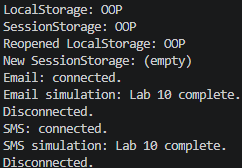

# Лабораторна робота №10. Абстрактні класи та інтерфейси

**Мета.** Реалізувати спільний контракт збереження даних та використати абстрактний клас для керування підключенням.

## Виконання роботи (варіант 10)

IStorage визначає методи Save і Load. LocalStorage записує значення у файли, а SessionStorage зберігає записи в словнику відповідного екземпляра. Програма викликає обидва методи через IStorage і перевіряє, що новий екземпляр LocalStorage бачить запис із тієї самої папки, а новий сеанс має порожній словник.

MessageSender оголошує абстрактні Connect і Send та реалізує спільний Disconnect. EmailSender і SmsSender імітують підключення і надсилання. SMS додатково перевіряє довжину повідомлення. Блок finally викликає Disconnect навіть за помилки надсилання.

## Контрольні запитання

1. Що задає інтерфейс? Спільні операції, завдяки яким клієнтський код може працювати з різними реалізаціями сховища.
2. Навіщо абстрактний клас? Він може зберігати стан підключення, надавати спільну реалізацію Disconnect і залишати спосіб надсилання похідним класам.
3. Як працює поліморфізм? Для елементів колекції виклики виконують реалізацію відповідного сховища чи відправника.

## Висновок

Програма викликає спільні контракти для двох способів зберігання та двох каналів надсилання. Демонстрація показує різний час життя даних і спільне завершення підключення.

## Запуск з кореня OOP-Zaluzhnyi

    dotnet run --project lab10v10

## Результат запуску

