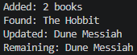
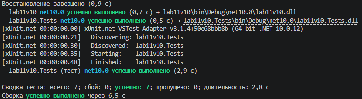

# Лабораторна робота №11. Узагальнений репозиторій

**Мета.** Реалізувати CRUD через узагальнений інтерфейс з обмеженням типу й покрити операції тестами.

## Виконання роботи (варіант 10 — Book)

- IEntity задає властивість Id. Book реалізує цей контракт і містить назву, автора та рік видання.
- IRepository<T> визначає операції GetById, GetAll, Add, Update і Delete. Обмеження where T : IEntity дає доступ до Id через параметр типу.
- InMemoryRepository<T> зберігає сутності в списку, відхиляє дублікати ID та повідомляє через KeyNotFoundException, якщо запитаний запис відсутній.
- xUnit-тести покривають усі операції, зокрема помилки для відсутнього ID й дубліката.

## Контрольні запитання

1. Обмеження where визначає можливості типу. Наприклад, where T : IEntity дозволяє читати Id, а where T : new() дозволяє викликати конструктор без параметрів.
2. IRepository відокремлює API роботи із сутностями від способу їх збереження. Клієнтський код звертається до спільного контракту.
3. Юніт-тести фіксують поведінку CRUD і граничних випадків при зміні реалізації.
4. Generics зберігають тип сутності на етапі компіляції. Клієнтові не потрібно приводити object до Book, щоб прочитати назву.

## Висновок

Один репозиторій підтримує сутності з Id. Демонстрація показує створення, читання, оновлення й видалення книг.

## Запуск з кореня OOP-Zaluzhnyi

    dotnet run --project lab11v10
    dotnet test lab11v10.Tests

## Результат запуску

