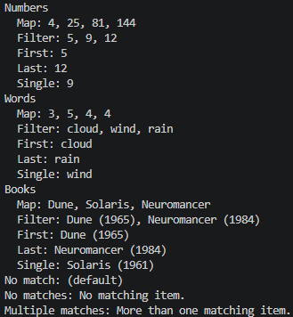

# Лабораторна робота №12. Узагальнені методи та делегати

**Мета.** Узагальнити операції над списками й передавати правила перетворення та відбору через делегати.

## Виконання роботи (варіант 10)

FunctionalUtils реалізує п’ять методів власними циклами. Map перетворює елементи, Filter формує список збігів, FirstOrDefault і LastOrDefault зупиняються на першому збігу у відповідному напрямку. Single перевіряє, що збіг рівно один. Кожен метод показано на числах, рядках і книгах.

## Контрольні запитання

1. Для чого потрібні делегати? Func передає правило перетворення або умову, яку метод застосовує до елементів.
2. Як працюють параметри типів? T визначає тип елемента списку. TResult дозволяє Map повернути список іншого типу, наприклад довжини рядків.
3. Коли потрібні обмеження типів? Якщо алгоритм викликає члени, доступні лише певним типам. Цим п’ятьом методам достатньо доступу до List і переданих делегатів.
4. Чим Single відрізняється від FirstOrDefault? Single перевіряє унікальність і викидає виняток за нуля або кількох збігів. FirstOrDefault повертає перший збіг або default(T).

## Висновок

Методи працюють з різними типами без дублювання алгоритмів. Приклади в консолі показують і звичайні результати, і поведінку за відсутності чи множинності збігів.

## Запуск з кореня OOP-Zaluzhnyi

    dotnet run --project lab12v10

## Результат запуску

