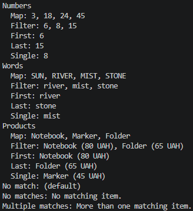

# Лабораторна робота №13. Узагальнені методи та делегати

**Мета.** Застосувати спільні алгоритми перетворення та пошуку до колекцій різних типів.

## Виконання роботи (варіант 10)

Методичка №13 задає ті самі п’ять методів, що й №12. У цьому окремому проєкті повторно використано реалізацію FunctionalUtils. Демонстрація працює з іншими даними: цілими числами, словами й об’єктами Product.

Map перетворює числа, нормалізує слова до верхнього регістру та отримує назви товарів. Filter залишає елементи за умовою. FirstOrDefault і LastOrDefault знаходять крайні збіги у вихідному порядку. Single повертає єдиний збіг і сигналізує про нуль або кілька збігів через виняток.

## Контрольні запитання

1. Як делегати допомагають повторно використовувати код? Метод отримує правило через Func, а його цикл працює однаково для всіх типів.
2. Навіщо окремий TResult для Map? Він дозволяє повернути тип, відмінний від типу джерела. Наприклад, зі списку товарів отримуємо список назв.
3. Що відбувається без збігів? FirstOrDefault і LastOrDefault повертають default для типу елемента. Single вимагає рівно одного збігу.
4. Коли потрібен where? Коли алгоритм використовує можливості певного типу. Ці методи отримують необхідну поведінку від делегатів.

## Висновок

Одна реалізація коректно обробляє три типи даних. Демонстрація перевіряє звичайні результати, значення за замовчуванням і обидві помилки Single.

## Запуск з кореня OOP-Zaluzhnyi

    dotnet run --project lab13v10

## Результат запуску

