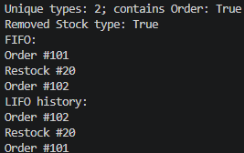

# Лабораторна робота №14. Обробка подій

**Мета.** HashSet відхиляє дублікати типів та підтримує перевірку наявності.

## Виконання роботи (варіант 10)

HashSet реєструє унікальні типи подій. Queue зберігає всі події в порядку надходження, а Stack повертає останню оброблену подію першою.

## Контрольні запитання

1. HashSet відхиляє дублікати типів та підтримує перевірку наявності.
2. Queue реалізує FIFO, тому першою обробляється найдавніша подія.
3. Stack реалізує LIFO, тому останню оброблену подію можна переглянути першою.

## Висновок

У консолі видно, що два замовлення належать одному типу, але обробляються окремо. Видалення типу з реєстру не видаляє події з черги. Порядок історії зворотний до порядку обробки.

## Запуск з кореня OOP-Zaluzhnyi

    dotnet run --project lab14v10 -c Release

## Результат запуску

