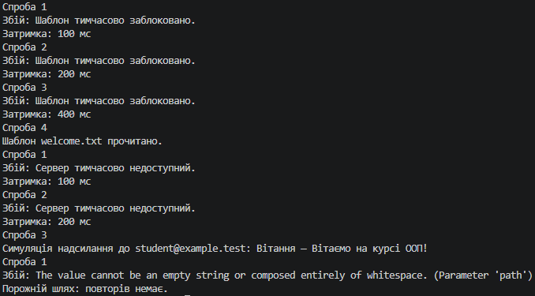

# Лабораторна робота №17. Обробка файлових і мережевих помилок

**Мета.** Навчитися обробляти тимчасові збої за допомогою патерна Retry та експоненційної затримки.

## Виконання роботи (варіант 10 — надсилання електронного листа)

- `FileProcessor.GetEmailTemplate` імітує три помилки `IOException` і повертає шаблон на четвертій спробі.
- `NetworkClient.SendEmail` імітує два збої `HttpRequestException` і повідомляє про успішне надсилання на третій спробі.
- `RetryHelper.ExecuteWithRetry<T>` записує спроби, причини збоїв і затримки. Делегат `shouldRetry` дозволяє повторювати обидва тимчасові збої. Порожній шлях спричиняє `ArgumentException` після першого виклику.

## Відповіді на контрольні запитання

1. При роботі з файлами можливі `IOException`, `FileNotFoundException` і `UnauthorizedAccessException`. При роботі з мережею трапляються `HttpRequestException` і тайм-аути. Рішення про повтор залежить від причини помилки.
2. Retry обмежує кількість повторних спроб і дає ресурсу час відновитися. Його застосовують до тимчасових збоїв, коли повтор операції безпечний.
3. Затримка перед повтором із номером `k` дорівнює початковій затримці, помноженій на `2^(k - 1)`. У демонстрації це 100, 200 та 400 мс.

## Висновок

Під час симуляції читання й надсилання відновилися після тимчасових збоїв. Фільтр винятків дозволив одразу завершити виклик із некоректним шляхом.

## Запуск з кореня OOP-Zaluzhnyi

```powershell
dotnet run --project lab17v10
```


