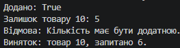

# Лабораторна робота №18. Власні винятки та патерн Result

**Мета.** Створити власний виняток із даними про помилку та використати `Result<T>` для очікуваних відмов операції.

## Виконання роботи (варіант 10 — управління інвентарем)

- `InventoryService.AddStock` додає одиниці товару і повертає `Result<bool>`. Недодатна кількість повертає результат із повідомленням про помилку.
- `InventoryService.DecreaseStock` списує товар. Якщо запасу бракує, метод викидає `ProductOutOfStockException` із властивостями `ProductId` та `RequestedQuantity`.
- У демонстрації до товару №10 додано 8 одиниць і списано 3. Додавання нуля повертає відмову, а запит списати 6 одиниць за залишку 5 обробляється через `catch`.

## Відповіді на контрольні запитання

1. Власний тип винятку дає змогу обробити конкретний збій в окремому блоці `catch` і передати предметні дані в типізованих властивостях.
2. У проєкті реалізовано конструктори без параметрів, із повідомленням та з повідомленням і внутрішнім винятком. Окремий конструктор приймає ідентифікатор товару й запитану кількість.
3. `Result<T>` повідомляє про успіх через `IsSuccess`, повертає значення через `Value` або пояснює відмову через `Error`. Такий контракт зручний для очікуваних помилок, які викликач може обробити звичайною перевіркою.
4. У цій роботі некоректна кількість при додаванні є очікуваною відмовою. Списання без достатнього запасу порушує контракт `DecreaseStock`, тому сервіс сигналізує про це власним винятком.

## Висновок

Результат додавання можна перевірити одразу, а виняток при списанні містить дані, потрібні для пояснення дефіциту. Після невдалих операцій залишок товару не змінюється.

## Запуск з кореня OOP-Zaluzhnyi

```powershell
dotnet run --project lab18v10
```


