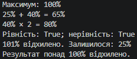

# Лабораторна робота №4. Властивості, статичні члени й оператори

**Мета.** Навчитися перевіряти значення у властивостях і визначати операції для власного типу.

## Виконання роботи (варіант 10 — Percentage)

Клас Percentage зберігає значення в приватному полі. Властивість Value приймає скінченні числа від 0 до 100. Статична властивість MaxPercentage повертає окремий об’єкт зі значенням 100%. Оператори + і * створюють нові об’єкти та перевіряють діапазон результату. Результат поза діапазоном спричиняє виняток. ToString показує відсоток, а Equals, GetHashCode, == і != використовують числове значення.

## Контрольні запитання

1. Властивість дає контроль над читанням і записом поля. У Value перевірка виконується до оновлення поля.
2. Статичний член належить типу. MaxPercentage доступна без створення окремого екземпляра класу.
3. Індексатор дає доступ до елементів за ключем або позицією. Percentage представляє одне число, тому індексатор тут не потрібен.
4. Перевантаження операторів визначає поведінку звичних операцій для власного типу. Однакові за Equals значення мають мати однаковий хеш-код.

## Висновок

Перевірка у Value захищає стан під час створення, зміни та арифметики. У консолі видно успішні операції й відхилення недопустимих значень.

## Запуск з кореня OOP-Zaluzhnyi

```powershell
dotnet run --project lab4v10
```

## Результат запуску


