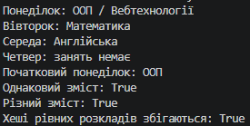

# Лабораторна робота №5. Індексатори та перевантаження операторів

**Мета.** Реалізувати доступ до даних за ключем і визначити об’єднання та рівність для власного типу.

## Виконання роботи (варіант 10 — TimeTable)

Розклад зберігається в Dictionary<string, string>. Індексатор читає або замінює запис за днем. Для відсутнього дня він повертає null. AddLesson дописує заняття, якщо на цей день уже є запис. Назви днів порівнюються без урахування регістру.

Оператор + створює новий розклад. При збігу днів заняття правого розкладу додаються після занять лівого. Оператори == і != порівнюють дні та заняття незалежно від порядку внесення записів. GetHashCode сортує ключі, щоб рівні розклади мали однакові хеші.

## Контрольні запитання

1. Індексатор дає доступ до даних за ключем через квадратні дужки. У цьому проєкті ключем є день тижня.
2. Оператор + визначає, як об’єднувати два розклади. Створення нового об’єкта дозволяє далі користуватися обома вихідними розкладами.
3. Equals, == та != мають узгоджено визначати рівність. Для рівних об’єктів GetHashCode повертає однакові значення.

## Висновок

Розклад підтримує читання й оновлення за днем. Демонстрація показує об’єднання спільного дня, відсутній день і рівність розкладів, заповнених у різному порядку.

## Запуск з кореня OOP-Zaluzhnyi

```powershell
dotnet run --project lab5v10
```

## Результат запуску


