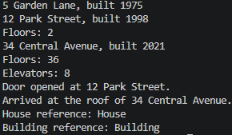

# Лабораторна робота №6. Наслідування

**Мета.** Застосувати наслідування, виклики базового конструктора та перевизначення методів.

## Виконання роботи (варіант 10)

- Building зберігає адресу й рік побудови та визначає virtual GetInfo.
- House додає кількість поверхів і метод OpenDoor.
- Skyscraper додає кількість ліфтів і метод GoToRoof.
- Обидва похідні класи викликають конструктор базового класу та доповнюють GetInfo через base.GetInfo.

## Контрольні запитання

1. Виклик base у конструкторі ініціалізує успадковану частину об’єкта.
2. virtual дозволяє похідному класу перевизначити метод. override забезпечує вибір реалізації за фактичним типом об’єкта.
3. new приховує метод. GetBuildingType для того самого об’єкта повертає House або Building залежно від типу змінної.

## Висновок

Виклик GetInfo через масив Building показує дані конкретної будівлі. Виклики GetBuildingType через змінні різних типів демонструють приховування методу.

## Запуск

    dotnet run --project lab6v10

## Результат запуску

