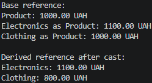

# Лабораторна робота №7. Приховування та перевизначення методів

**Мета.** З’ясувати, як тип змінної та фактичний тип об’єкта впливають на виклик методу.

## Виконання роботи (варіант 10)

- Product визначає віртуальний метод GetPrice і повертає базову ціну 1000 грн у демонстрації.
- Electronics перевизначає GetPrice через override і додає 10% до базової ціни.
- Clothing приховує GetPrice через new і застосовує знижку 20%.
- Програма викликає методи через змінні типу Product і після явного приведення до Electronics та Clothing.

## Контрольні запитання

1. Як працює override? Виклик віртуального методу обирає реалізацію за фактичним типом об’єкта. Electronics повертає 1100 грн в обох випадках.
2. Як працює new? Прихований метод обирається за типом посилання. Clothing повертає 1000 грн через Product і 800 грн через Clothing.
3. Що змінює приведення типу? Воно змінює тип виразу, через який викликається метод. Сам об’єкт лишається тим самим.

## Висновок

Перевизначення підтримує поліморфну поведінку в базовому контракті. Приховування створює окремий метод, доступ до якого залежить від типу виразу.

## Запуск з кореня OOP-Zaluzhnyi

    dotnet run --project lab7v10

## Результат запуску

