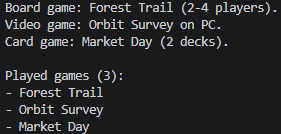

# Лабораторна робота №8. Поліморфізм і динамічне зв’язування

**Мета.** Продемонструвати виклик різних реалізацій віртуального методу через спільний базовий тип.

## Виконання роботи (варіант 10 — поліморфні ігри)

- Game зберігає назву та визначає віртуальний метод Play.
- BoardGame зберігає мінімальну й максимальну кількість гравців.
- VideoGame зберігає платформу, а CardGame — кількість колод.
- Кожен похідний клас перевизначає Play і виводить відомості про свою гру. Програма викликає Play для елементів List<Game>, додає зіграні ігри до окремого списку та виводить їхні назви.

## Контрольні запитання

1. Що таке динамічне зв’язування? Під час виклику віртуального методу середовище виконання обирає реалізацію за фактичним типом об’єкта.
2. Навіщо потрібні virtual і override? virtual дозволяє змінити поведінку базового методу, а override надає реалізацію в похідному класі.
3. Як List<Game> підтримує різні типи ігор? Він зберігає посилання базового типу. Для кожного елемента виклик Play обирає реалізацію відповідного класу.

## Висновок

Один цикл запускає настільну, відео- та карткову гру через спільний метод Play. Після запуску програма виводить список усіх зіграних ігор.

## Запуск з кореня OOP-Zaluzhnyi

    dotnet run --project lab8v10

## Результат запуску

