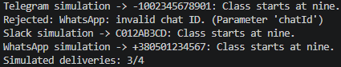

# Лабораторна робота №9. Поліморфні сервіси

**Мета.** Реалізувати спільний контракт надсилання, перевірку даних і незалежну обробку помилок у черзі повідомлень.

## Виконання роботи (варіант 10)

MessageSender оголошує абстрактний метод SendMessage. TelegramSender приймає числовий ідентифікатор, WhatsAppSender — номер із префіксом +, а SlackSender — буквено-цифровий ідентифікатор каналу. Це правила формату для навчальної симуляції. Програма не звертається до зовнішніх сервісів.

NotificationService.SendAll перебирає записи з об’єктами базового типу, викликає їхній метод і обробляє ArgumentException окремо для кожного запису. У демонстрації один некоректний ідентифікатор відхиляється, а три коректні повідомлення проходять симуляцію.

## Контрольні запитання

1. Навіщо спільний базовий клас? Він задає метод, який сервіс викликає однаково для всіх каналів.
2. Де перевіряти формат? У конкретному відправнику, бо кожна платформа має свої правила.
3. Як ізолювати помилку повідомлення? Обробити виняток у тілі циклу, щоб перейти до наступного запису.

## Висновок

Кожен відправник реалізує власну перевірку. Загальний сервіс продовжує обробку після відхилення одного повідомлення.

## Запуск з кореня OOP-Zaluzhnyi

    dotnet run --project lab9v10

## Результат запуску

